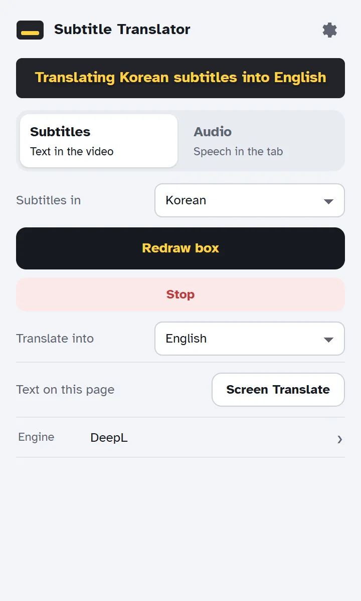
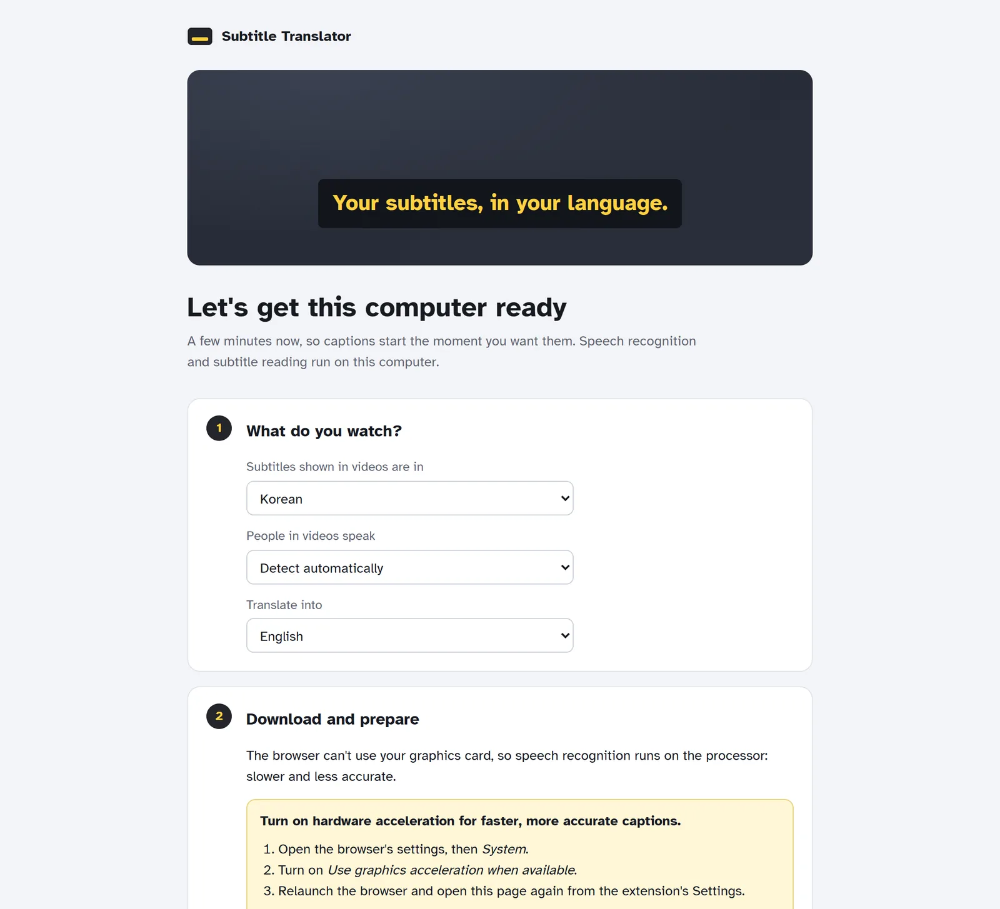

# Auto Subtitle Translator

A Chrome extension that translates video as you watch it.


- **Subtitles mode:** draw a box around subtitles that are *burned into* the
  picture (Korean on a League of Legends stream, Spanish on football, Japanese
  on anime) and the translation appears over them, in place. A rough box is
  fine. On YouTube most lines are translated before they appear.
- **Audio mode:** translated captions from what people say in the tab. On
  YouTube each caption appears as its words are spoken.
- **Screen Translate:** drag a box over text on any page for a one-shot
  translation.

Speech recognition and subtitle reading run **on your computer**, in the
browser, on the graphics card when there is one. Only text goes out, to the
translation service you choose. Translation is **fast then best**: DeepL or
Google puts a translation up at once, then Claude replaces it with one that
knows what the video is about (title, channel, description) and keeps names
consistent through a learned glossary.

| Popup | First-run setup |
|---|---|
|  |  |

## Highlights

Every number comes from an automated run in a real browser; details in
[docs/performance.md](docs/performance.md).

**Burned-in subtitles**
- **0.20 s** from a subtitle appearing to its translation on screen (0.48 s
  including a real DeepL round trip).
- On-device OCR (PaddleOCR on WebGPU through ONNX Runtime Web): **2.3%
  character error, 22 ms per frame**. Tesseract was benchmarked and rejected
  (17.4%).
- **Read-ahead:** taps the YouTube player's Media Source stream, decodes the
  buffered video ahead of playback with WebCodecs, and translates subtitles
  about 28 s before they appear: **29 of 29 lines** ready in time.
- **Works with the box people actually draw:** loose, the whole lower half,
  too high, tall and narrow. Every shape reads 14–15 of 15 lines in the browser
  test (four of them read none before), and 89–94% across 8 hand-labelled
  videos in 5 languages. Stream chat, logos, scorebugs and game notices are
  told apart from the subtitle.

**Speech**
- Whisper runs in the browser. On YouTube the audio the player has buffered
  is transcribed ahead, so captions land **0.02–0.1 s** after the words start.
- First-run setup does the one-time GPU preparation of the large speech model
  (10 minutes once on an RTX 3070); Audio mode then starts in **7.1 s**.

**Translation**
- Claude with video context and a glossary was judged **0.93 vs 0.50 for
  DeepL** on Korean League subtitles, and beat DeepL in blind comparisons on
  Spanish football, anime and a Korean drama.
- About **$3.40 per hour of video** with Claude Opus, which sets the
  subscription pricing ([docs/pricing.md](docs/pricing.md)).

**Hosted service** (built, not yet deployed): Node, Hono and SQLite with
email-code sign-in, Stripe billing and a metered translation proxy, packaged
for Docker on Google Cloud.

**Verified by machines:** 588 unit tests and 67 browser tests in one
`npm run verify` gate. Playwright drives a real Chrome with the extension
loaded: real tab audio, OCR on real video frames, real DeepL and Claude, real
YouTube, and Claude grading the translations.

**Stack:** TypeScript, Chrome MV3 (service worker, offscreen document, content
scripts), WebGPU, WebCodecs, Media Source Extensions, ONNX Runtime Web,
transformers.js, the Claude API, DeepL, Node, Hono, SQLite, Stripe, Docker,
Google Cloud, Playwright and Jest.

## Status

Subtitles mode, Audio mode, Screen Translate, context-aware translation, the
first-run setup, a debug panel and the hosted service are built and verified.
What stands between this and the Chrome Web Store, and what comes after, is
in the [launch plan](docs/launch-plan.md). Measured wins, newest first:
[docs/milestones.md](docs/milestones.md). The whole project on one page:
[docs/project-overview.md](docs/project-overview.md).

## Install (developer build)

```bash
npm install
npm run build          # development build into dist/
```

Chrome → `chrome://extensions` → Developer mode → **Load unpacked** → `dist/`.
On first install a setup page opens: pick your languages and click
**Download and prepare** (it can be reopened from Settings → Troubleshooting →
Setup and tips). Then open the popup's Settings and add a DeepL (free keys end
in `:fx`) or Google Translate key, and an Anthropic key (or an
Anthropic-compatible gateway) for context-aware translation. Keys stay in this
browser's local extension storage.

`npm run package` builds the Chrome Web Store zip into `release/` (production
build without the test-only page matches).

## Use

The popup's **caption bar** says what is happening in the tab ("Translating
Korean subtitles into English"); below it are the two modes, **Translate
into** and **Screen Translate**. Keys, subscription, engine, glossary, caption
style and theme live behind the gear.

**Subtitles mode:** on the video page open the popup → **Subtitles** → the
subtitle language → **Draw subtitle box** → drag a box over where the
subtitles appear. The box is remembered per video (**Use saved box** next
time). Each line stays up long enough to read (at least 1.5 s, longer for long
lines), a new subtitle replaces it at once, and pausing freezes it.

**Audio mode:** popup → **Audio** → **Start live captions**. Settings offers
the best-accuracy speech model (1.6 GB, needs a graphics card) or a smaller one
(590 MB); without a usable graphics card an 80 MB model runs on the processor.
On YouTube captions are made ahead from the buffered audio; elsewhere live
captions follow the video (nothing new while paused or during an ad, a seek
clears the screen).

**Translation engine** (Settings): *Fast then best*, *Fast only* or *Best
only*, and the Claude model. **Glossary for this video** lists the names and
terms Claude fixed (뽀삐 → Poppy); correct one and the lines using it are
re-translated.

**Debug panel** (Settings → Troubleshooting): shows on the page what the
extension is doing (capture, speech model, read-ahead, translations, errors),
with a Copy report button. Keys are shown only as set or not set.

## Privacy

Video frames and audio never leave your computer. Recognised text goes only to
the translation service you picked (with Claude, also the video's title,
channel and description). No analytics or tracking. The hosted service stores
an account's email, plan and usage totals, never the text it translates.
Details: [docs/privacy.md](docs/privacy.md) (draft).

## How it works

| Piece | Where |
|---|---|
| Subtitles mode: frame sampling → change detection → OCR → translation → per-video timeline → overlay | `src/subtitle/` |
| Read-ahead (YouTube): taps the player's MSE stream in the page, decodes buffered video and audio ahead of playback with WebCodecs | `src/subtitle/readAhead/` |
| OCR: PaddleOCR PP-OCRv5 (ONNX Runtime Web, WebGPU with wasm fallback) in a worker inside a hidden extension iframe; picks the subtitle out of other on-screen text and learns each video's subtitle size | `src/ocr/`, `src/subtitle/textSize.ts` |
| Speech: tab capture → voice activity detection → Whisper (transformers.js) worker in an offscreen document; read-ahead windows with sentence timestamps | `src/offscreen.ts`, `src/whisper.worker.ts`, `src/audio/` |
| First-run setup: languages, graphics card check, prepares the models through the same workers ahead of use | `welcome.html`, `src/welcome.ts`, `src/setup/` |
| Translation: fast tier (DeepL / Google) and best tier (Claude with video context, topic summary, glossary, batching) | `src/translation/`, `src/background.ts` |
| Hosted service: email-code accounts, Stripe billing, metered translation proxy | `server/` ([server/README.md](server/README.md)) |
| Popup and debug panel | `popup.html`, `src/popup.ts`, `src/debug/` |

Design documents and decision records: `docs/superpowers/`.

## Testing

Playwright drives a real browser with the extension loaded (Chromium by
default; installed Chrome with `E2E_BROWSER=chrome` for real WebGPU).

```bash
npm run fixtures:video   # once: downloads the test videos (Python venv in e2e/.cache)
npm run verify           # types + lint + unit + browser tests + live DeepL
```

| Command | What |
|---|---|
| `npm test` | Jest unit tests (extension and server) |
| `npm run test:e2e` | Browser tests: popup, setup page, Screen Translate, captions, Subtitles mode (OCR, live path, read-ahead, 8 box shapes) |
| `npm run test:live` | Real DeepL (`DEEPL_API_KEY` in `.env`) and real Claude through a relay |
| `npm run e2e:youtube` | Subtitles mode on real YouTube (installed Chrome, opt-in) |
| `npm run e2e:judge` | Claude scores the displayed translations (opt-in) |
| `npx playwright test --project=perf perf-setup-gpu` | First-time GPU setup on the setup page vs Audio mode start (installed Chrome, `E2E_CLEAR_GPU_CACHE=1`) |
| `npx playwright test --project=docs` | Regenerates the screenshots in `docs/images/` (real DeepL) |
| `npm run perf:stt` | Speech model benchmark |

Test pages, audio and frame-labelled subtitle timelines are in
`e2e/fixtures/`; reports land in `e2e/.perf/`. Harness details and gotchas:
`CLAUDE.md`.
